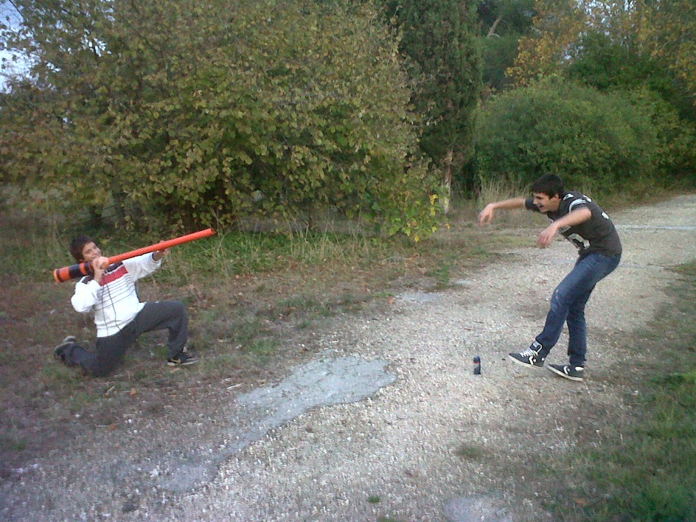

Ohhhhhhhhhh finalmente dopo tante volte sono riuscito a convincere i miei amici a usare lo spara-patate che abbiamo costruito un po' di tempo fa. Beh, il funzionamento è molto facile, lo spara-patate è formato da 2 tubi in PVC uniti da un riduttore, un tubo funge da canna, e uno da camera di combustione, immettiamo una certa quantità di deodorante nella camera, e poi con un tipo di accendino elettrico che genera degli archetti dentro la camera di combustione facciamo esplodere il gas che espandendosi aumenta la pressione sulla patata che è incastrata nella canna e la spara via...

_(video non più disponibile)_
