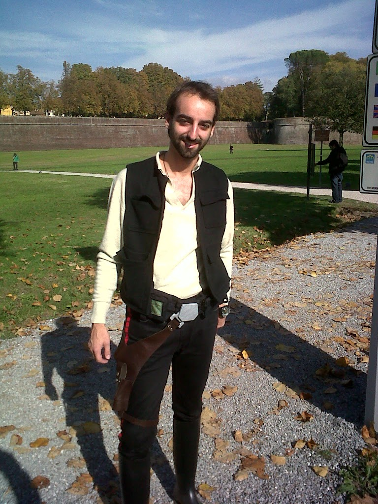
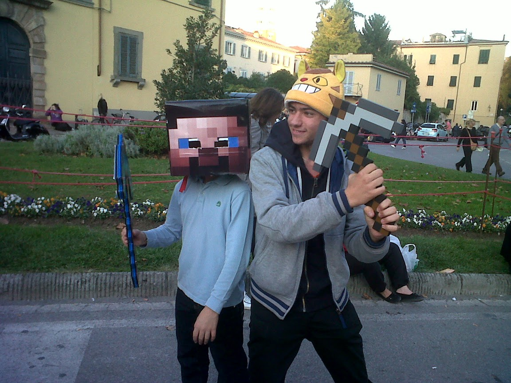
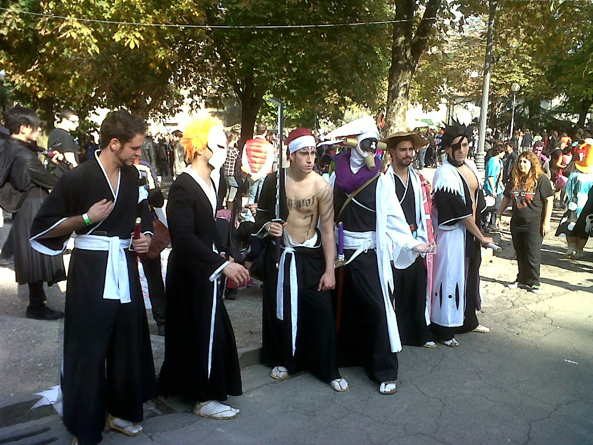

Eh già ci sono andato :D Ieri l'altro mi sembra il 29 sono andato con un mio amico a Lucca per *ovviamente* partecipare al Lucca Comics XD

Siamo arrivati verso le 19, quando tutti gli stand chiudevano quindi non abbiamo fatto il biglietto e siamo andati un po' a giro nei negozietti tra le stradine di Lucca, e abbiamo visto qualche cosplayer che si era trattenuto dopo la chiusura...

Il 29 ci siamo andati solo perchè sennò non sapevamo che fare XD Infatti dopo cena siamo andati a dormire da questo mio amico che ha una casa a Fucecchio, e il giorno dopo saremmo andati a Lucca todo il giorno...  
Ecco, ci siamo svegliati anche tardi per le mie aspettative ( 10:30 ~ ), e siamo andati in macchina a Lucca... ... ... ve lo Sconsiglio! Traffico, traffico, e tanto traffico, non nell città stessa ma solo per entrare a Lucca XD Alla fine abbiamo parcheggiato vicino alla stazione verso le 12:00 e siamo andati alla biglietteria...pensavo peggio in nemmeno 10 minuti avevamo il biglietto ed eravamo pronti ad divertirci tutto il giorno...

Subito prima di entrare abbiamo visto Han Solo ( l'unico XD ), fatto anche bene :D  
Ovviamente c'era tantissima gente, appena entrati siamo riusciti a prendere una mappa a "The Citadel" e abbiamo studiato un po' come e dove muoverci, e ci siamo diretti agli stand della 501st Legione :D  
Durante il tragitto abbiamo incontrato personaggi conosciutissimi :D

Uno si era persino vestito da omino di Minecraft D:

Abbiamo visto anche molti Jack Sparrow, e molti cosplayer di Bleach ;)

C'erano anche molti vestiti da studenti di Hogwarts, e alcuni vestiti anche molto bene ;)

Molti erano vestiti da personaggi di Bleach, e molti altri anche da Halo, e Space Marine...  
Uno era persino vestito da Space Marine del Caos, e ci diceva che il vestito lo aveva fatto lui e che solo l'elmo alla fine era costato 300 euro D:

Sempre durante il tragitto verso la 501st legione, abbiamo visto che c'era un torneo medioevale di spade XD

E ho scoperto che esiste una Scuola di scherma con spade laser dove insegnano i 7 stili di combattimento descritti in Star Wars, peccato che in Toscana non ci sia una sede :(

Arrivati allo stand di Star Wars, siamo rimasti colpiti dai particolari dei costumi dei cosplayer :O Erano uguali agli originali :D

")

Veramente una bellissima esperienza che non dimenticherò mai, è proprio una cosa da non perdersi, sia il Lucca Comics sia il Lucca Games, che abbiamo girato per almeno 1 ora e mezzo, tra GDR, giochi di carte, giochi di ps3,pc, e xbox, e vari tornei multiplayer online :D

Beh quello che mi rimane di questo evento è sicuramente il piacere di avervi partecipato e di aver fatto foto ( il prossimo anno ne farò molteeeeee di più )

Inoltre mi porto a casa una maglietta di Star Wars de "L'impero colpisce ancora" e una bellissima spada :D

Tutte le immagini dell'evento le trovate a questo link: Album _(link non più disponibile)_
