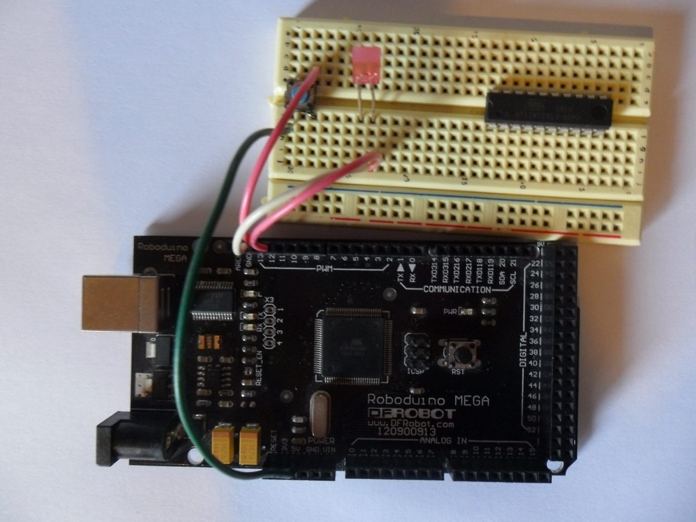

Hei, salve a tutti ;)

Oggi *finalmente* mi è venuta la voglia di postare qualcosa di *serio* su Arduino ;)

In questi giorni mi sono messo a sviluppare una libreria per la connessione seriale tra il pc e Arduino. Questa libreria comprende varie funzioni di base per utilizzare Arduino, per esempio scrittura e lettera digitale/analogica, ma contiene anche funzioni per interagire con la EEPROM e altro.

Questa libreria l'ho scritta soprattutto per necessità perché se per natale tutto va bene, mi faccio regalare BeagleBoard e insieme ad Arduino ci farò di tutto quindi mi serviva un modo facile per fare interagire queste 2 boards ;)

La libreria è scritta interamente in C, e non presenta grandi difficoltà nella comprensione del codice. Però non è del tutto completa, si possono implementare comunque altre funzioni e migliorare quella già esistenti.

Un bug a me noto ma non ancora risolto è quello che ogni tanto sembra che Arduino non invii più dati sulla seriale, ciò rimane a me inspiegabile o.O basta un reset e tutto torna a funzionare. Altro problema è l'utilizzo di pinGet all'interno dei loop, che pare non funzionare correttamente probabilmente a causa dei dati e della velocità della seriale, vedrò di sistemare questo bug separando le linee di scambio dati tra input e output utilizzando le altre connessioni seriali dell'ArduinoMega ( ne ha in tutto 4 ).

Qui a fianco l'esempio utilizzato con arduino-test.c

Lasciate stare quell'ATtiny2313 che non fa parte del nostro circuito ma che oggi ho provato a programmare on scarsissimi risultati XD

Beh che dire... vi lascio con un video della libreria e di Arduino :D lo potrete vedere appena youtube me lo carica :D


