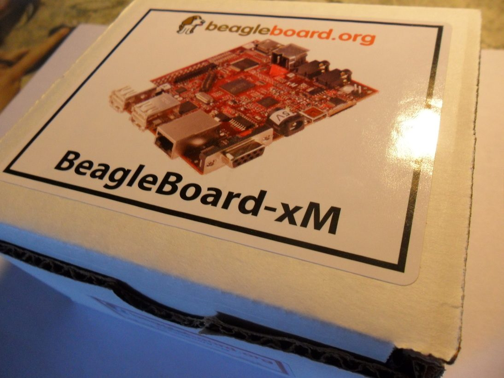
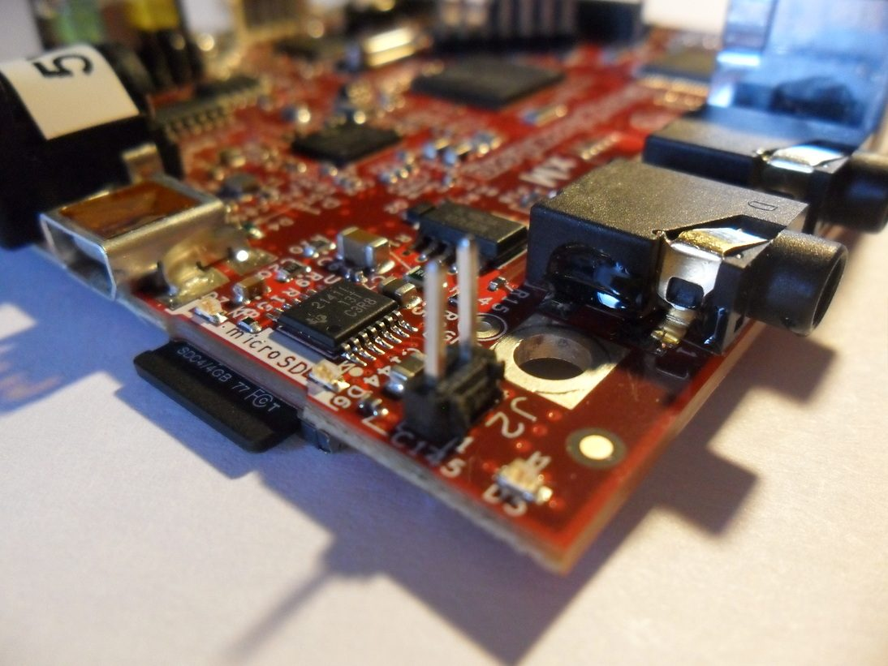
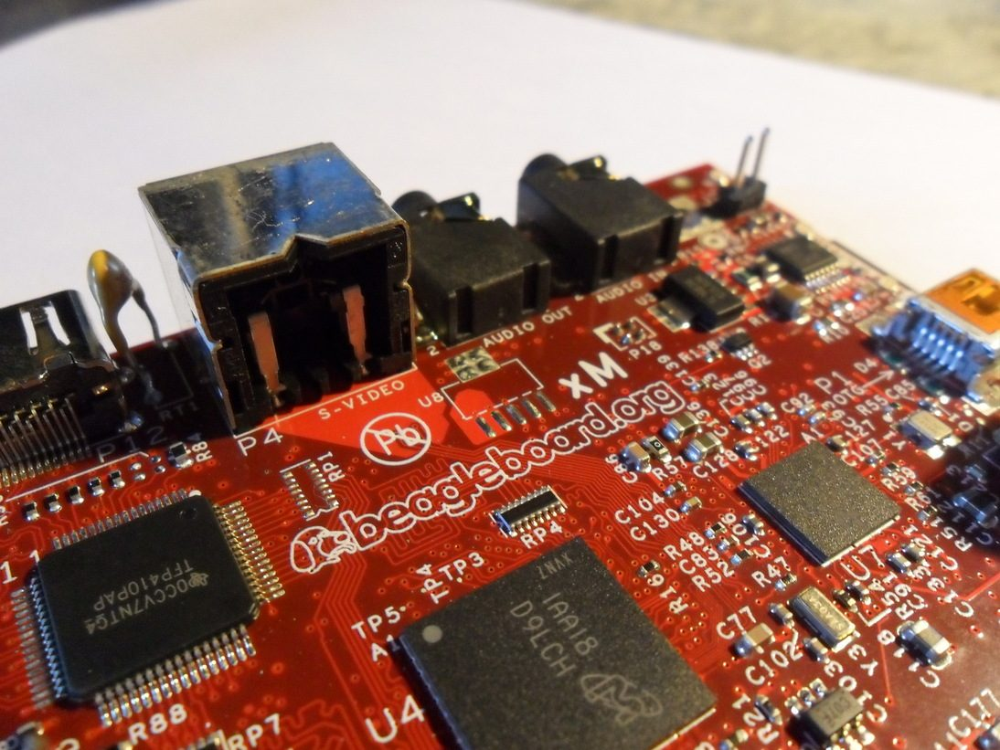

Beh, rieccoci qui proprio dopo Natale e proprio dopo aver ricevuto qualcosa....

Indovinate un po' cosa mi è arrivato? Beagleboard ... era scontato...

Comunque è un oggetto veramente figo, ho iniziato ad usarla proprio oggi e ho avuto qualche problema già da subito dato che la distribuzione Armstrong nella microSD da 4GB mi dava un bel "Kernel Panic", per fortuna utlizzando Ubunti 11.10 minimal tutto è andato ;)

A breve foto e video...


