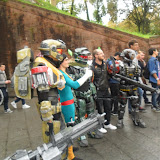

Eh beh anche quest'anno il Lucca Comics ha ospitato la imponente presenza del celeberrimo Marco Mori...

Ovvio, e anche quest'anno mi son divertito moltissimo. La mia permanenza al Lucca Comics è stata di ben 2 giorni, venerdi e sabato (2-3)...

Una bellissima esperienza, ho mangiato il Ramen ... veramente e incredibilmente (nel vero senso della parola) buono.  
Ho bazzicato prevalentemente nel reparto Games, comprando qualche carta di Magic per il mazzo, provando Halo 4 e imparando a giocare a Warhammer 40k...

Non sono riuscito a vedere tutto, né a vedere tutti...ho scoperto solo dopo che Zeb89 era presente LOL

Oltre a visitare a fondo il Games ho fotografato tantissimi cosplayer alcuni erano veramente uguali all'originali O\_O

Con un mio amico abbiamo girato anche molto nelle parti di The Citadel con l'intenzione di comprarci qualcosa per un futuro cosplay (abbiamo deciso lui guerriero, io mago).

Mi è piaciuta molto la presenza di una zona adibita a "Trono di Spade" in concomitanza con l'uscita dell'ultimo libro "La Danza dei draghi" che io avevo ordinato e che avevo già a casa :D

Comunque metto qui l'album con tutte le foto ;)

Lucca Comics 2012 _(link non più disponibile)_


